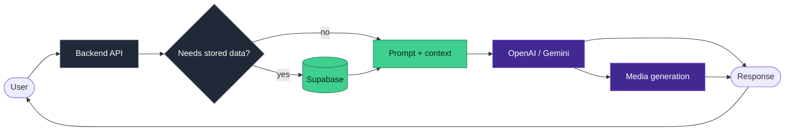

I build <b>LLM-powered products end to end</b> — API integration, backend, data layer, deployment. 
Currently at <b>Hodos360 AI</b>, shipping AI features to external customers on Vercel and AWS.

---

## How I build conversational AI

Context is retrieved **conditionally** — records are pulled into the prompt only when the query needs them, rather than stuffing context into every request.

---

## What I build

<table>
<tr>
<td width="50%" valign="top">

### Conversational AI
Direct OpenAI and Gemini API calls in code. Multi-turn context handling and Supabase-backed retrieval.

</td>
<td width="50%" valign="top">

### Generative media
Images, ad creatives, and video via OpenAI, Gemini, and Seedance through the Kie.ai API layer.

</td>
</tr>
<tr>
<td width="50%" valign="top">

### Automation
Event-driven n8n workflows and GoHighLevel CRM automation across internal production systems.

</td>
<td width="50%" valign="top">

### Motion interfaces
React and Three.js — 3D, animation, and frontends that do more than sit still.

</td>
</tr>
</table>

---

## Selected work

| Project | What it is | Stack |
|---|---|---|
| [laaraasourcingindia](https://github.com/Barathchander88/laaraasourcingindia) | Live client website for a garment sourcing company | HTML · CSS · JS · PHP |

> [!NOTE]
> Chatbot and Three.js repos going public soon.

<b>Background</b>

 

**Hodos360 AI** — AI Engineer / Full-Stack Developer, Oct 2025 – present
**Zenanvibe** — Full-Stack Developer Intern, Jan – Sep 2025
**B.E. Computer Science and Design**, Erode Sengunthar Engineering College, 2025

Also work with C, C++, Embedded C and IoT systems from my engineering background.

---

Tiruppur, Tamil Nadu, India

