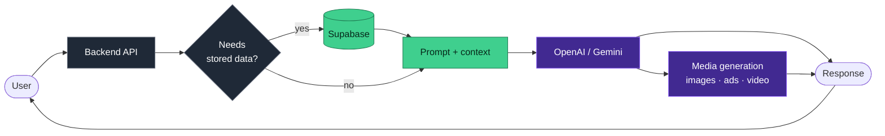

<h1 align="center">Barath Chander E</h1>

<b>AI Engineer &amp; Full-Stack Developer</b> 
I build LLM-powered products end to end — API integration, backend, data layer, deployment.

Currently at **Hodos360 AI**, shipping AI features to external customers on Vercel and AWS.

---

### How I build conversational AI

Context is retrieved **conditionally** — records are pulled into the prompt only when the query needs them, rather than stuffing context into every request.

---

### What I build

**Conversational AI, from scratch.** Direct OpenAI and Gemini API calls in code, multi-turn context handling, Supabase-backed retrieval.

**Generative media pipelines.** Images, ad creatives, and video via OpenAI, Gemini, and Seedance models through the Kie.ai API layer.

**Automation that replaces manual work.** Event-driven n8n workflows and GoHighLevel CRM automation across internal production systems.

**Interfaces with motion.** React and Three.js — 3D, animation, frontends that do more than sit still.

---

### Selected work

| Project | What it is | Stack |
|---|---|---|
| [laaraasourcingindia](https://github.com/Barathchander88/laaraasourcingindia) | Live client website for a garment sourcing company | HTML · CSS · JS · PHP |

> [!NOTE]
> Chatbot and Three.js repos going public soon.

---

B.E. Computer Science and Design, 2025 · Tiruppur, Tamil Nadu, India 
<a href="https://www.linkedin.com/in/barath-chander-eb99972227">LinkedIn</a> · barathchander88@gmail.com

